# Satellite change at Bridges to Prosperity sites, Rwanda

Can a satellite change model trained only on Rwanda DHS villages track how households near Bridges to Prosperity
(B2P) footbridges changed between survey rounds? This repo applies the model of
[village-wealth-change](https://github.com/ziameanslight/wealthchange) to the B2P Scale-up Household Survey panel:
141 bridge sites, about 14,500 households, baseline 2020/21 and three follow-up rounds to 2023/24.

**In short:** the satellite model ranks villages by **grid electrification** (Spearman ρ 0.19, 0.15 within districts).
This is the item it also ranks best in its Rwanda DHS training data. For the other items that match the DHS (phones,
floors, TVs) and for consumption, correlations with the B2P data are small or zero.

---

## 1. Dependency: village-wealth-change

Everything satellite-related comes from a local clone of
[village-wealth-change](https://github.com/ziameanslight/wealthchange) (set `VWC_REPO`; default
`../village-wealth-change`) and its workspace (`VC_WORK`; default `<VWC_REPO>/work`). This repo uses that clone's:

| From village-wealth-change | Used for |
|---|---|
| `data/models/ms/t2025.pt`, `src/cnn_ms.py` | the multi-scale CNN for test year 2025: trained on wealth **levels** of every rural DHS + LSMS cluster surveyed before 2025, never on change. Its 64-d embedding is one input. |
| `data/feats_160m.npz`, `src/pairs.py`, `src/common.py` | the Rwanda DHS matched village pairs, their observed change, and the 160 m AlphaEarth features |
| `$VC_WORK/data` (`aef_fine`, `aef_ms`, `final`, `households.parquet`, `aef/aef_index.parquet`) | the DHS place inputs and the AlphaEarth file index |
| `pipeline/fetch_aef_fine.py`, `fetch_aef_coarse.py`, `build_multiscale.py` | reading AlphaEarth tiles around the B2P households |

The features are those of village-wealth-change's **hybrid ridge**. For each place and year:
- `emb`: the CNN embedding, from 1.28 km at 10 m, 25 km at 160 m and 100 km at 640 m;
- `sat`: mean AlphaEarth embedding in 1.28, 2.56 and 10.24 km squares at 160 m (192 values).

A change is `features(later year) − features(earlier year)`.

## 2. Model: Rwanda DHS only, tested on every B2P bridge

1. **Training** (`scripts/b2p_dhs_ridge.py`):
   - Data: the 52 Rwanda DHS matched village pairs of village-wealth-change (2019→2023, 2019→2025, 2023→2025).
   - One row per place of a pair (98 rows): `[Δemb, Δsat, gap in years]` → observed change.
   - One ridge per target: IWI, and the DHS items that the B2P survey also asks about (table below).
   - The penalty is chosen by 5-fold cross-validation grouped by pair.
   - **No B2P data is used in training.**
2. **Test** (`scripts/b2p_features.py`, `b2p_dhs_ridge.py`):
   - Each B2P household gets its own features at its own GPS point. Each household's satellite composite is the
     year of its interview date minus 6 months, so the imagery gap equals the survey gap.
   - Each household's predicted change since baseline is averaged to village × wave means (villages with ≥ 20
     households).
   - This covers all arms (built, long-term control, not yet built) and both river sides: 1,179 village-waves in
     395 villages at 140 bridges.
3. **Scoring** (`scripts/b2p_item_scatter.py`):
   - Pearson r and Spearman ρ, where Spearman handles the many villages with no change.
   - AUC for "any gain" (0.5 = chance), and Spearman among the villages that gained.
   - Within-district versions: predictions and ranks centred on district × wave means.
   - 95% CIs and p-values from a bootstrap that resamples whole bridges.

### Matching the DHS variables

The DHS wealth index (IWI) is built from 12 item groups. The B2P export has a direct or partial match for 4 of
them, which together make up about 41% of the IWI weight. The other 9 components of the B2P asset index (roof,
walls, beds, solar, dish, gas, livestock, renting out land) have no DHS counterpart.

| DHS item (IWI weight) | B2P item | Match |
|---|---|---|
| Electricity (8.06) | main lighting source is the grid | direct (a proxy: lighting source, not connection) |
| TV (8.61) | owns a television | direct |
| Phone (7.13) | number of mobile phones (0 / 1 / 2+) | partial (DHS: any phone; the index uses any phone) |
| Floor (natural −7.56 / finished +1.23) | improved floor (cement, tile, stone, wood) | partial (B2P counts wood and stone as improved) |
| Fridge, car, bicycle, radio / watch, computer / motorbike, water source, toilet, sleeping rooms | — | not in the B2P export |

The **DHS-matched index** applies the IWI weights to the four items (grid 8.06, TV 8.61, any phone 7.13, improved
floor 7.56) for observed and for predicted change.

## 3. Results

### Electrification comes out top, as in the Rwanda training data

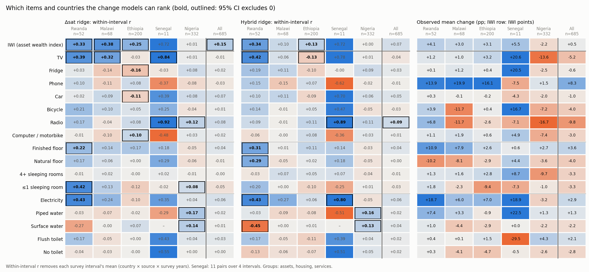

*From village-wealth-change (figure 4): within-interval r of predicted vs observed change, by item and country. In
Rwanda the strongest item is electricity (0.43 for both models).*

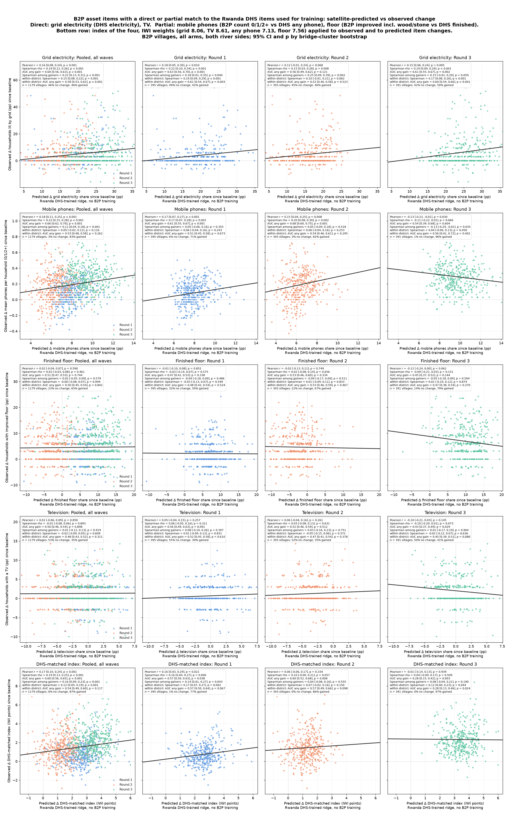

*Satellite-predicted vs observed change at B2P villages, for the four matched items and the DHS-matched index, pooled
and by wave.*

| Pooled over waves [95% CI] | Grid electricity | Mobile phones | Finished floor | TV | DHS-matched index |
|---|---|---|---|---|---|
| Spearman ρ | **0.19** [0.12, 0.26] | 0.22 [0.15, 0.28] | 0.02 | −0.01 | **0.19** [0.13, 0.25] |
| AUC any gain | **0.60** [0.56, 0.63] | 0.66 | 0.51 | 0.50 | 0.60 |
| Spearman among gainers | **0.22** [0.13, 0.31] | 0.11 | 0.02 | 0.01 | 0.16 |
| Within district: Spearman | **0.15** [0.08, 0.22] | 0.05 (n.s.) | 0.00 | −0.02 | 0.12 [0.05, 0.19] |
| Within district: AUC | **0.58** [0.53, 0.62] | 0.53 (n.s.) | 0.50 | 0.48 | 0.54 (n.s.) |

- **Grid electricity** is ranked in every wave (ρ 0.15–0.22), on both whether a village gained and how much, and
  mostly within districts. This mirrors the Rwanda DHS result, where electricity is the best-ranked item.
- **Phones** look ranked when pooled, but almost every village gained phones (83%). The signal is between districts
  and over time, and it reverses in round 3.
- **Floors and TVs** show no signal.
- The **DHS-matched index** does about as well as electricity alone: electricity carries it.
- The correlations are **small**. Electricity's ρ of 0.19 explains under 4% of the variance in ranks. The predicted amounts are
  too large: most villages show no observed change in grid lighting while the model predicts gains of 5–35 pp.

### Satellite-visible items and consumption

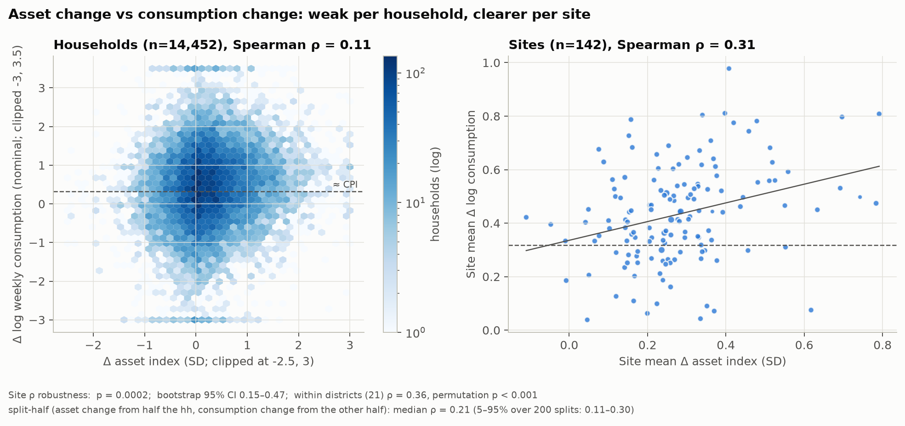
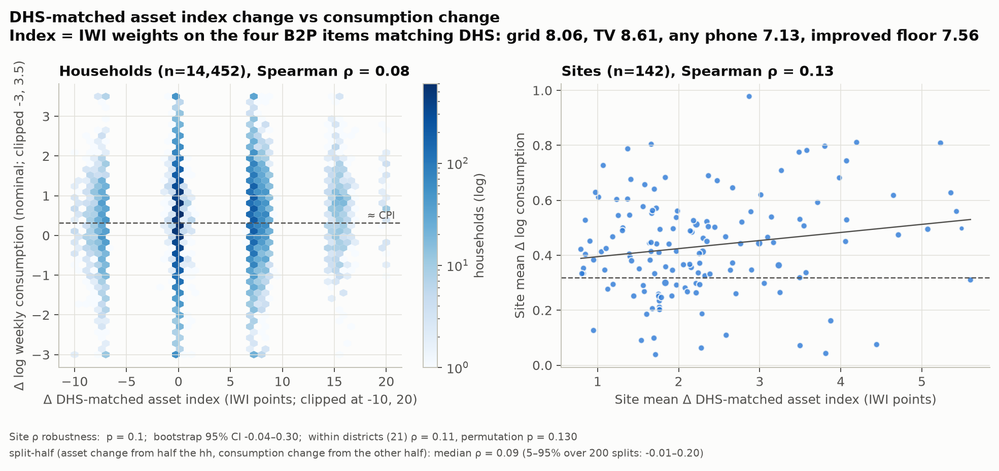
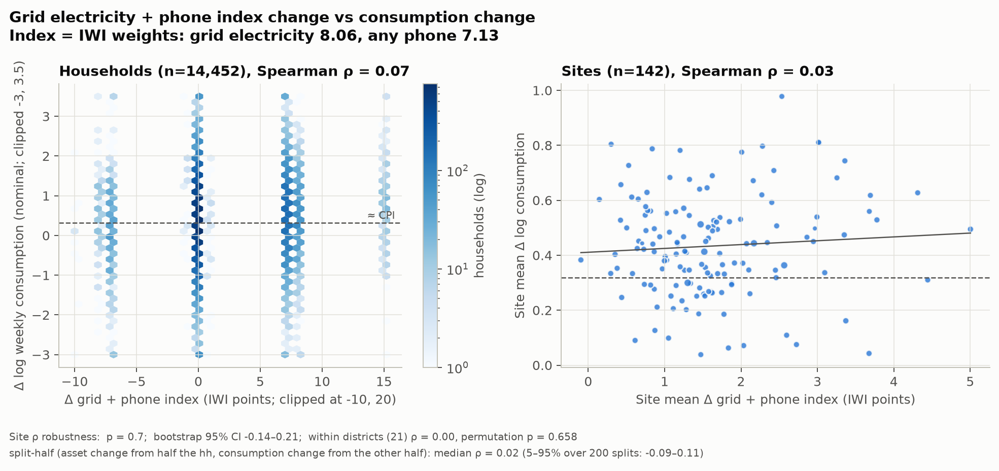

*Change in asset index vs change in log weekly consumption, baseline → round 3, per household and per site: the full
13-item B2P index (top), the DHS-matched index (middle), grid + phone only (bottom).*

| Index | Sites ρ | Within districts ρ |
|---|---|---|
| Full B2P asset index | **0.31** (p 0.0002) | 0.36 |
| DHS-matched (grid, TV, any phone, floor) | 0.13 (p 0.1) | 0.11 |
| Grid + phone | 0.03 (p 0.7) | 0.00 |

The items that move with consumption in this survey are housing materials, beds, solar and livestock, not the
DHS-matched ones. This **does not show that consumption change is invisible from space**. It shows that the current
model, trained on DHS items, only picks up electrification. A model able to see the other items (roofs, walls,
livestock, cropland) might still track them (to-do ii).

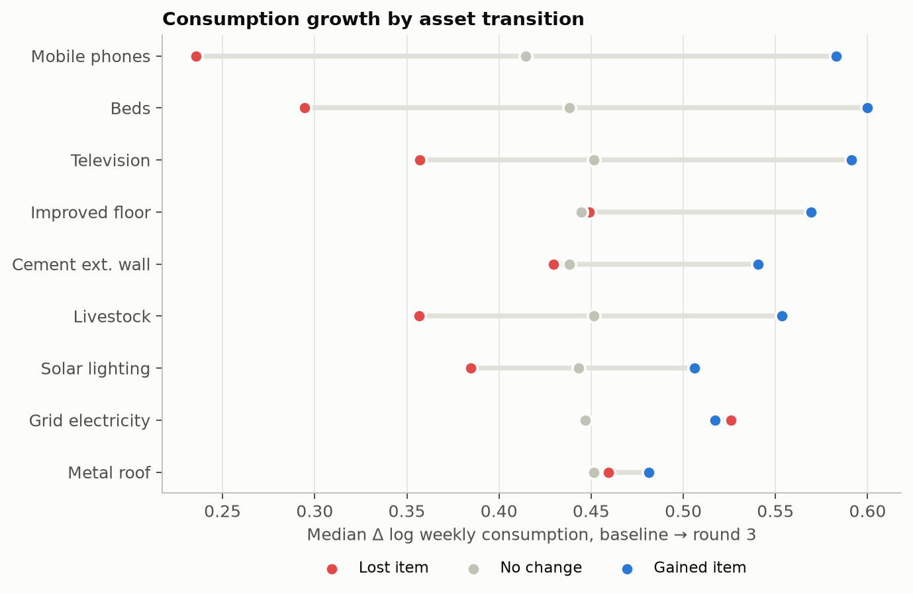

### The B2P panel: what changed

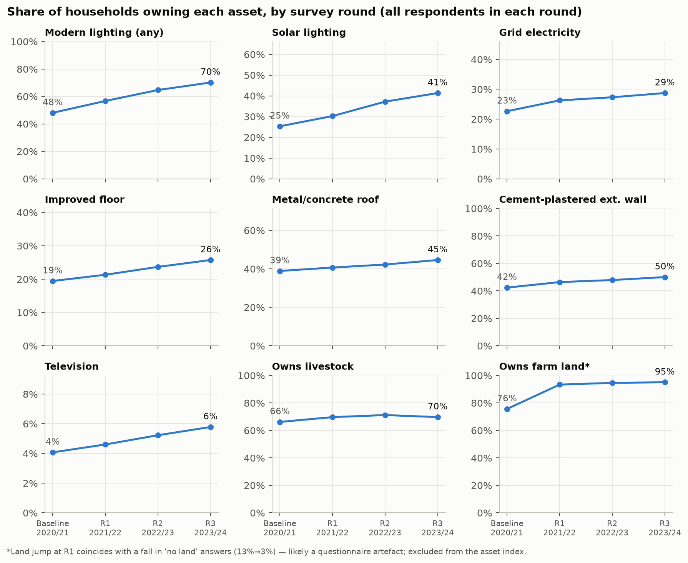
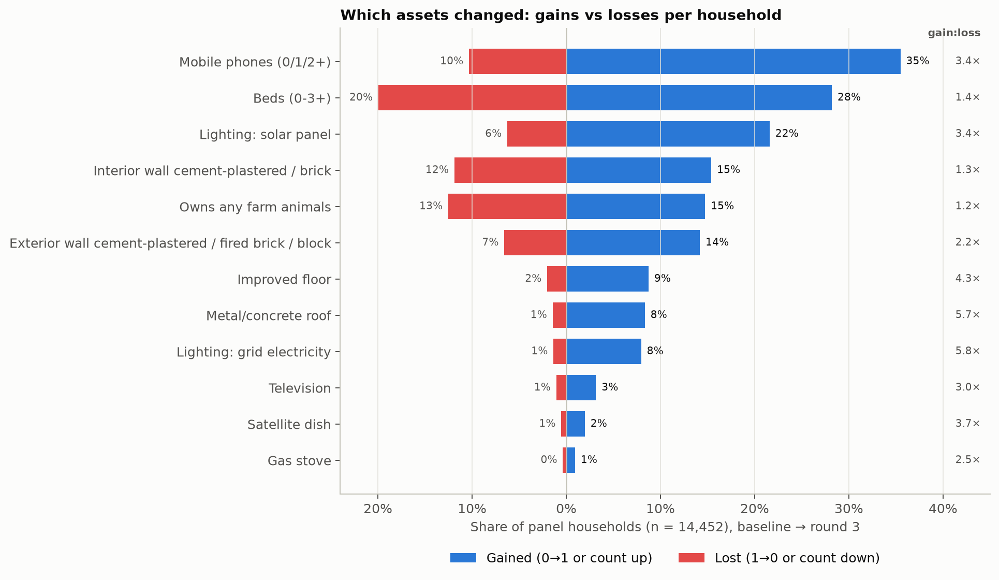
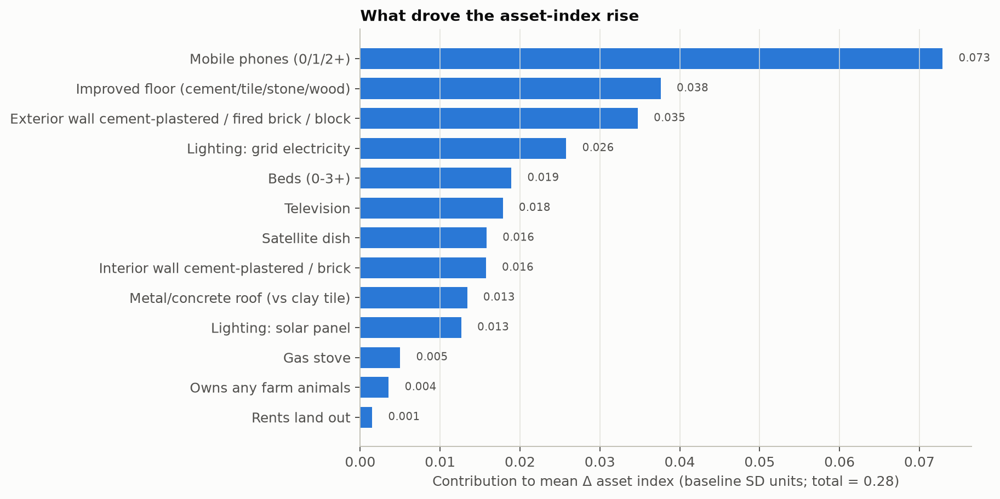
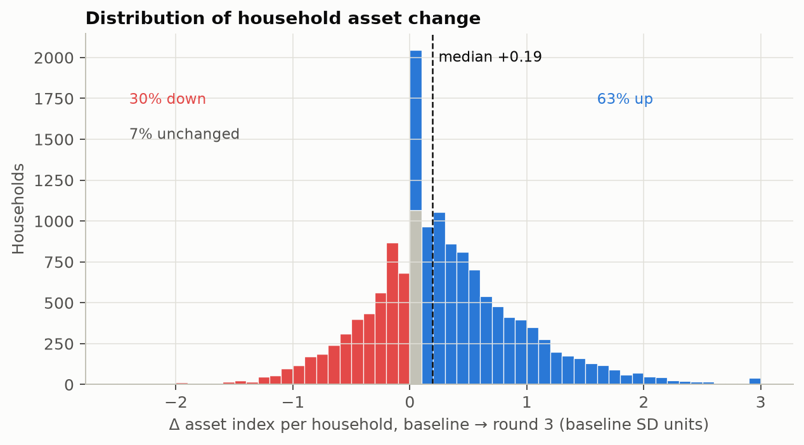
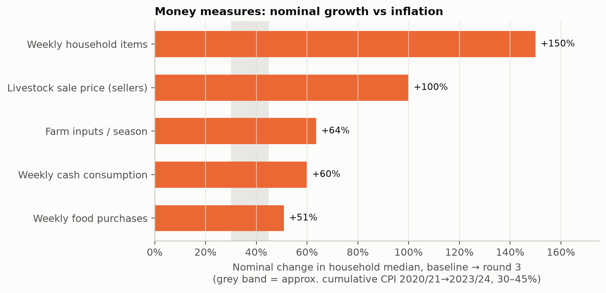
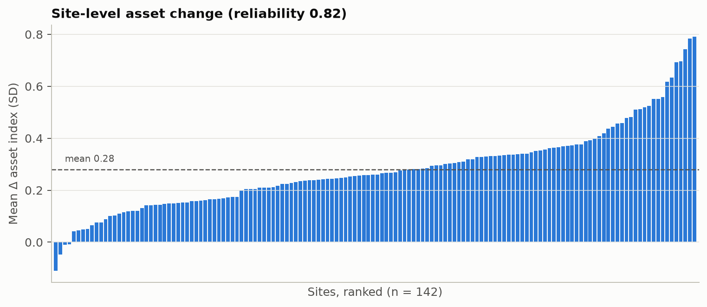

## 4. To do

1. **Missing variables in the mWater pull.** The questionnaire's income, harvest, job, business, remittance and
   other-income rosters are not in the current export, and total expenditure is 98% missing. Pull them from mWater and
   update to see whether there is an income signal.
2. **Other assets and consumption between waves.** Is it possible to pick up the other B2P assets (roof, walls,
   solar, livestock, land under crops) and consumption between waves at the B2P bridges, with targets or features
   beyond the DHS items?
3. **Higher temporal frequency.** AlphaEarth is annual. A foundation model with monthly embeddings (e.g. Temov) might pick up change within and between survey rounds (harvests, construction, new
   connections) that an annual composite averages away.
4. **Country-specific fine-tuning.** This repo uses a Rwanda-specific fit: the ridge is trained on Rwanda DHS pairs
   only. In village-wealth-change, skill differs by country and by item (electricity and TV in Rwanda, TV in Malawi,
   the composite in Ethiopia, nothing in Nigeria). If the satellite features or other inputs can't be improved,
   applying this approach elsewhere will likely need a country-specific fine-tune.

## 5. Reproduce

The B2P survey microdata is not public and is not in this repo. Put the mWater export and the bridge list in
`b2psurvey data/` (git-ignored): `B2P Scale-up Household Survey(3).csv` and `rct_bridges.csv`. Everything
derived from them at household or village level (`data/`) is git-ignored. Only figures are
committed.

```bash
pip install -r requirements.txt            # plus a village-wealth-change clone with its data/ and workspace
export VWC_REPO=../village-wealth-change VC_WORK=<its workspace>
python -I scripts/b2p_match.py             # match survey sites to bridges -> data/hh_points.parquet
python -I scripts/b2p_change.py            # household panel and asset index -> data/hh_rounds.csv, hh_change.csv
python -I scripts/b2p_plots.py             # figures 01-08
python -I scripts/b2p_fetch_aef.py         # AlphaEarth 10 m tiles and 160 m overviews around households (~21 GB)
python -I scripts/b2p_features.py          # CNN embedding + 160 m features per household-year (~6 min, GPU)
python -I scripts/b2p_dhs_ridge.py         # Rwanda-DHS-only ridges -> village x wave predictions
python -I scripts/b2p_item_scatter.py      # figure 21
```

`plots/00_vwc_items_by_country.png` is copied from village-wealth-change `figures/fig4_items_by_country.png`.
